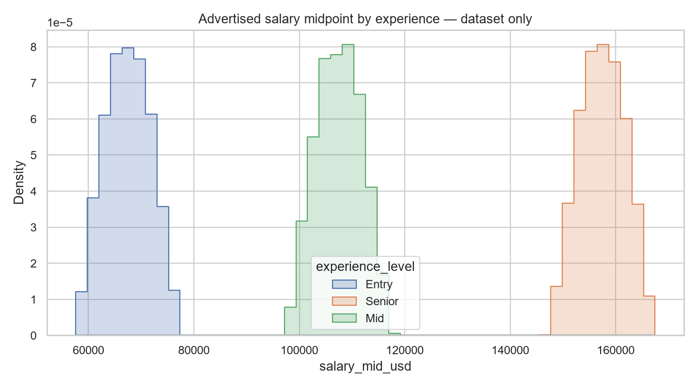

# AI Job Market Lab

An end-to-end, multi-task data science project built from **Global AI & Data Science Job Market (2020–2026)**. It audits relational data, rejects target shortcuts, compares ML pipelines, performs Optuna AutoML and tuning, and serves predictions through Streamlit and FastAPI.

**The data audit is central to this project.** Experience years perfectly identify seniority; the Remote city token identifies work arrangement. Only **4.1% of jobs** join to the skills table. Models exclude those shortcuts, skills experiments use exact matches only, and outputs make dataset limitations visible. Market provenance is unverified: these results are educational evidence about this dataset, not verified global hiring trends.

## Get started

Run from the project root using Python 3.12:

```bash
python -m venv .venv
# Windows PowerShell: .venv\Scripts\Activate.ps1
# macOS/Linux: source .venv/bin/activate
python -m pip install -r requirements.lock.txt
python -m pip install -e . --no-deps
job-market all --trials 8 --search-rows 6000
python -m pytest -q
python scripts/quality_audit.py
```

The public Kaggle API normally works without authentication. Existing CSVs under `data/raw/` are reused. If public access fails, authenticate the official Kaggle CLI locally and run:

```bash
kaggle datasets download -d mann14/global-ai-and-data-science-job-market-20202026 -p data/raw --unzip
job-market all
```

No credentials belong in this repository. All outputs remain inside the project root. If pip's network transport stalls, the optional `python scripts/bootstrap_wheels.py` fallback obtains verified official PyPI wheels. No external notebook service is required.

## Explore and predict

```bash
streamlit run app/streamlit_app.py
python -m uvicorn api.main:app --host 127.0.0.1 --port 8000
```

Streamlit: [localhost:8501](http://localhost:8501). API documentation: [localhost:8000/docs](http://localhost:8000/docs).

`POST /predict/{task}` accepts salary, experience, remote, skills or salary_width. Example:

```json
{
  "job_title": "Data Scientist",
  "company_type": "Startup",
  "industry": "Tech",
  "country": "USA",
  "company_size": "Medium",
  "posted_year": 2026,
  "experience_level": "Mid",
  "remote_type": "Hybrid"
}
```

Responses include the selected model, validation metrics, educational/experimental status and limitations. Salary tasks include nominal 90% calibrated intervals. Extra/leaky fields are rejected. `/health` reports model availability and `/models` returns metadata. The service runs locally; public hosting is outside this project's deployment scope.

## What is included

- Five supervised tasks, global and experience-group median/stratified/prevalence baselines, linear models, random forests and regression gradient boosting.
- Word/bigram title TF-IDF experiment; no invented job descriptions.
- Train-only imputation, category encoding, scaling, three-fold CV and eight Optuna model-family/hyperparameter trials per task/split.
- Random holdout and temporal 2026 holdout; 2025 regression calibration; bootstrap confidence intervals.
- Permutation explainability, probability calibration diagnostics, confusion matrices, per-skill metrics, group error analysis and distribution drift.
- Enforced SQLite keys, orphan quarantine, complete data dictionary, source hashes and target/leakage audit.
- Streamlit filters, plots, predictions and validation views; typed FastAPI endpoints; automated data, model, API and app tests.
- Reusable CLI, executed exploration notebooks, decision log, CI and full-training artifact workflow.

## Results and decisions

See [final report](reports/final_report.md), [model comparisons](reports/model_comparison.csv), [data quality](reports/data_quality.json), [target decisions](docs/target_discovery.md) and [decision log](docs/decision_log.md). Models are chosen by training CV, never by test ranking. Weak targets remain visible as failed experiments. Skills are always exploratory because of relationship coverage. See [architecture](docs/architecture.md), [dictionary](docs/data_dictionary.md) and [reproduction details](docs/reproducibility.md).



## Project layout

```text
data_science_project_dsai/
├── README.md, LICENSE, .gitignore, .env.example
├── requirements.txt, requirements.lock.txt, pyproject.toml
├── data/              # raw, interim, processed, attribution and hash manifest
├── notebooks/         # executed exploration and validation
├── src/jobmarket/     # preparation, EDA, training, inference and CLI
├── models/            # ten fitted artifacts plus JSON metadata
├── app/               # Streamlit
├── api/               # FastAPI
├── reports/           # figures, experiments, audit and final report
├── docs/              # architecture, dictionary and project decisions
├── tests/             # data/model/API/application tests
├── scripts/           # verification and environment helpers
└── .github/workflows/ # CI and optional full retraining
```

Raw CSVs, derived databases, model binaries and per-record results remain local and are regenerated by `job-market all`. Summary evidence and all project code are committed. [Dataset](https://www.kaggle.com/datasets/mann14/global-ai-and-data-science-job-market-20202026): Mann Raval (mann14), version 3, [CC BY 4.0](https://creativecommons.org/licenses/by/4.0/). Original raw files are unchanged; transformations are documented. Project code is MIT licensed.
