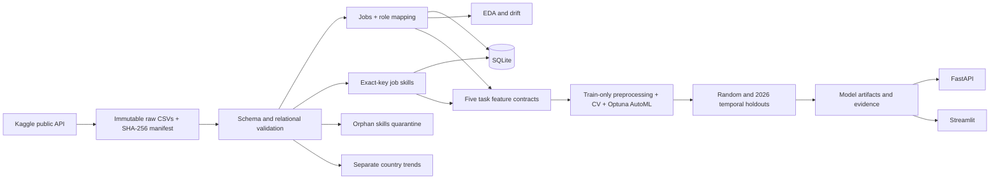

# Architecture

All project paths derive from the installed source's project root. Run entry points from `data_science_project_dsai/`. No dataset or output path is machine-specific.

`jobs` has one row per unique job ID. `role_mapping` has one row per title and a many-to-one FK from jobs. `job_skills` has one row per `(job_id, skill)` and an enforced FK to jobs. `country_trends` has one row per `(country, year)` and is a separate analytical source, not a predictive enrichment. `orphan_skills` retains unmatched source rows without implying valid jobs.

No employer identifier or employer history is available, so company-level grouping cannot be claimed. Unique job IDs prevent duplicate-ID contamination, but unseen employers and near-duplicate real postings cannot be assessed. Exact duplicate rows and key uniqueness are audited.

Service routes use fixed task names and curated Pydantic categories. Extra fields such as salary endpoints and city are rejected by the API. Inference reads only task-specific columns and local trusted model files. Models are cached by task. Restart the API/Streamlit process after retraining to invalidate cached artifacts.

SQLite is for reproducible analysis, not multi-user production storage. FastAPI and Streamlit should run locally. Neither includes account authentication or a public hosting deployment. The full-training CI workflow reproduces model binaries on demand; routine CI downloads public source data and tests preparation, analysis and app behavior without spending a full training budget.
